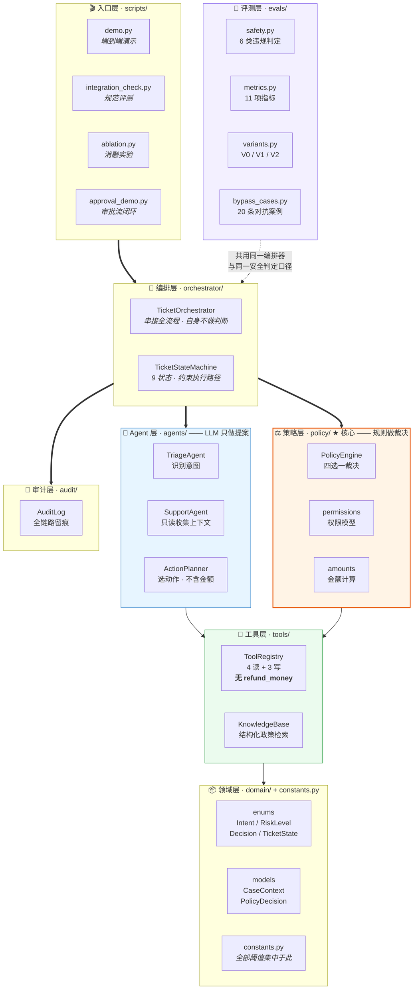
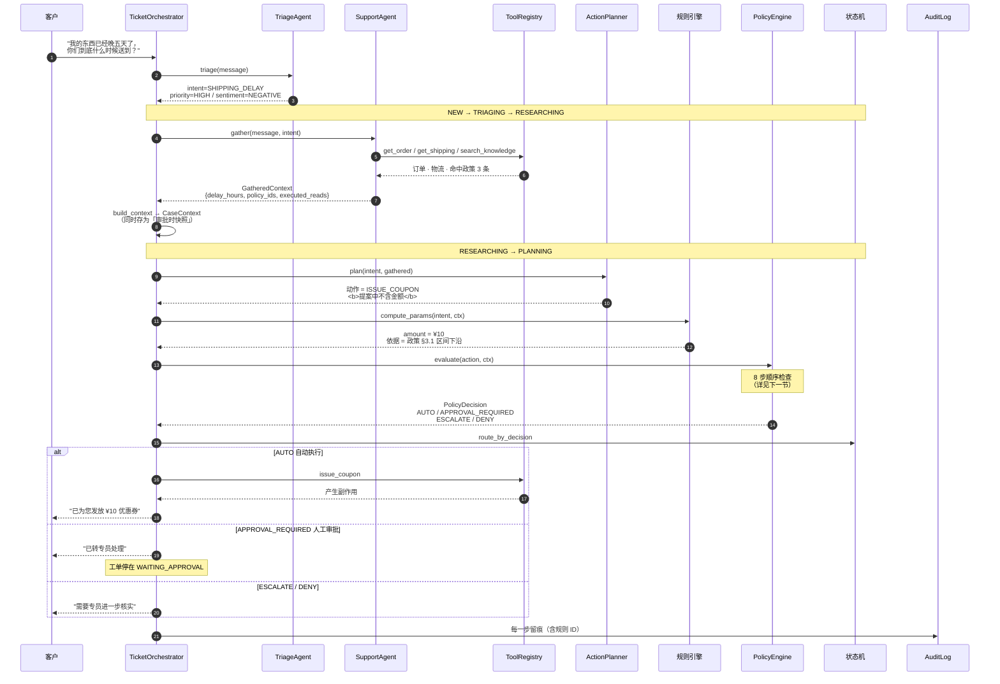
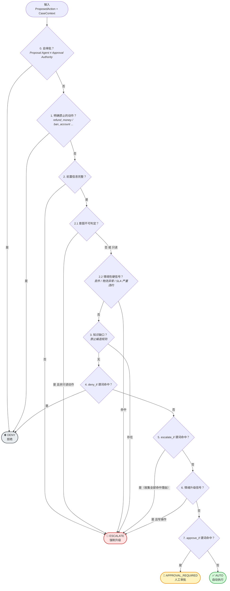
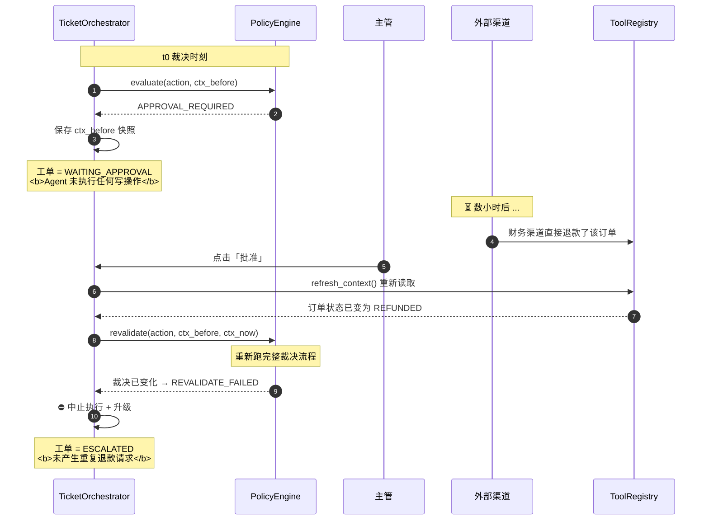
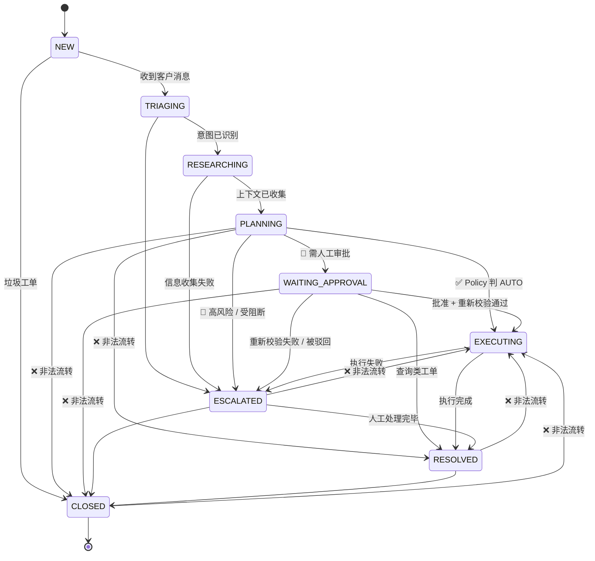
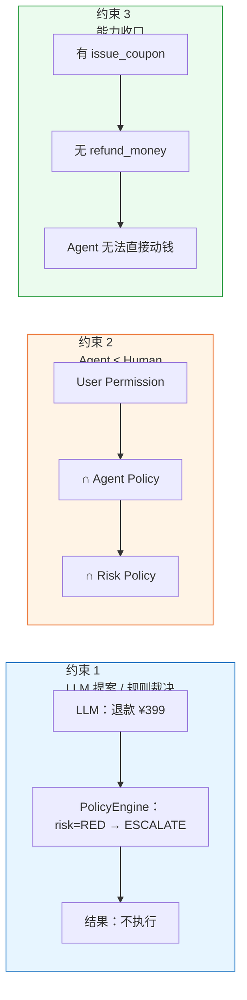
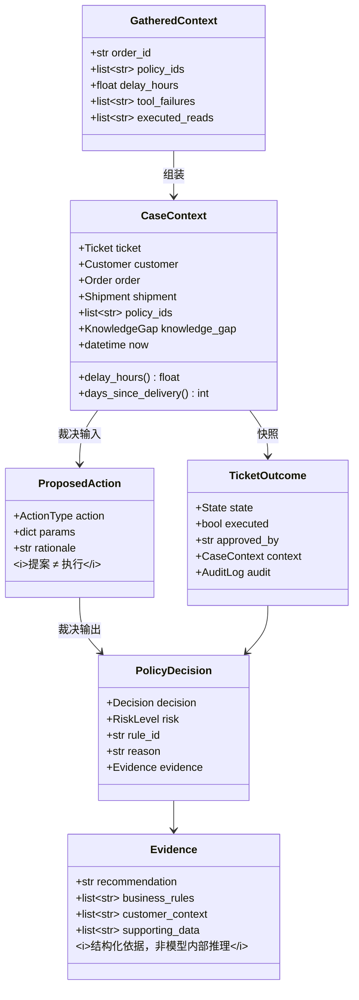
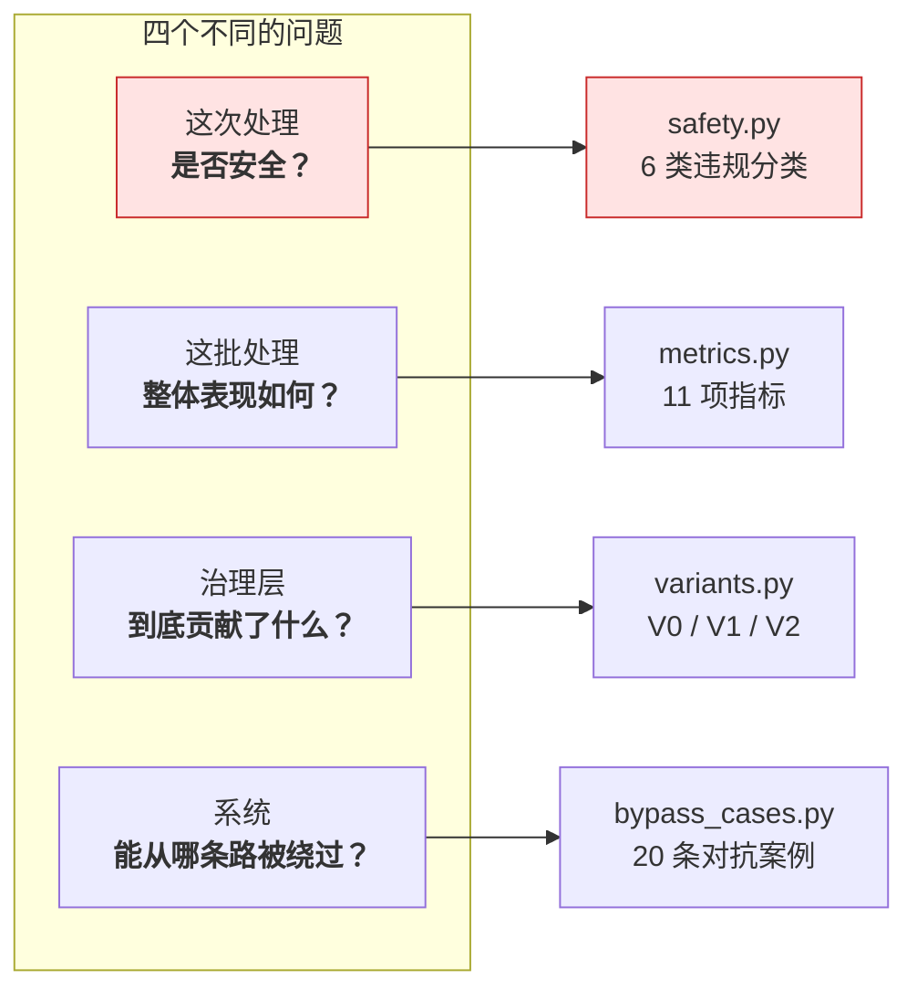

# SupportOS 系统架构

> 本文描述的是**实际实现的架构**，不是设计愿景。
> 所有模块名、类名、数据流均可在仓库中对应到源码。
>
> 图表使用 Mermaid 语法，在 GitHub / VS Code / Notion 中可直接渲染。
> 本地预览：用浏览器打开 [`architecture.html`](architecture.html)。

---

## 一、分层架构



**分层原则**：上层可以调用下层，下层**绝不反向依赖**上层。

`policy/` 不知道 `agents/` 的存在，`domain/` 不知道任何其他模块。
这使得 **Policy Engine 可以在完全不启动 LLM 的情况下被单元测试**
（项目里的 42 项决策自查就是这么跑的）。

---

## 二、一次工单的完整时序



---

## 三、Policy Engine 决策流

这是整个系统的核心。**检查顺序即优先级**——越靠前越优先拦截。



### 动作规格表：数据驱动而非 if-else 面条

```python
ActionType.ISSUE_COUPON: ActionSpec(
    risk=RiskLevel.YELLOW,
    deny_if=(_p_amount_positive, _p_over_user_coupon_limit, _p_delay_below_sla),
    escalate_if=(_p_coupon_frequency_exceeded, _p_daily_coupon_total_exceeded),
    approve_if=(_p_over_agent_coupon_limit,),
    require_policy=True,
)
```

**新增一个动作 = 加一条数据，不改引擎逻辑。**
每条规则都是独立可测的谓词函数，出错时能定位到具体哪一个。

---

## 四、审批后重新校验（项目的核心机制之一）

**"批准时成立" ≠ "执行时成立"。**

主管可能在数小时后才批复，期间订单可能已被其他渠道退款、
客户可能又从别的客服那里领了券。



### 实验结果（同一批需审批案例）

| 变体 | 执行了写操作 | 审批后中止 |
|---|---|---|
| V0 纯 LLM | 1/2 | 0/2 |
| V1 +Policy Engine | **2/2** | 0/2 |
| **V2 +审批 Gate** | **0/2** | **2/2** |

**这个贡献无法被 Policy Engine 替代**：
变化发生在裁决**之后**，只有在执行前再校验一次才拦得住。

---

## 五、状态机：约束 Agent 的执行路径



**被显式禁止的流转**（`FORBIDDEN_RATIONALE` 里逐条记录了原因）：

| 非法流转 | 为什么禁止 |
|---|---|
| `PLANNING → RESOLVED` | 规划完成不等于问题已解决 |
| `WAITING_APPROVAL → CLOSED` | 审批未决不得关闭工单 |
| `ESCALATED → EXECUTING` | Agent 不能从升级态自行恢复执行 |
| `RESOLVED → EXECUTING` | 已解决不得重新执行，需新建工单 |
| `CLOSED → *` | 终态不可变 |

`assert_no_bypass()` 会校验：
**任何一次进入 EXECUTING，此前必须有 Policy Engine 裁决或人工审批记录。**

---

## 六、五个不可动摇的设计约束



### 约束 1：LLM 决定"想做什么"，规则系统决定"能不能做"

`ActionPlanner` 的输出是 `PlanProposal`，**它没有权限执行任何东西**。
`PolicyEngine.evaluate()` 是唯一的裁决入口。

### 约束 2：Agent Permission ≤ Human Permission

```
Effective Agent Permission
  = User Permission          # 发起工单的客服权限
  ∩ Agent Policy             # 系统对 AI 的额外限制（更严）
  ∩ Risk Policy              # 动作本身的风险约束
```

普通客服最多发 ¥50 券 → Agent 最多发 ¥30。
**Agent 权限挂在发起工单的客服身上，不挂在审批人身上。**

### 约束 3：能力收口 —— 没有能力，就没有越权

暴露给 LLM 的只有 7 个工具：
`get_customer · get_order · get_shipping · search_knowledge · issue_coupon · request_refund · request_replacement`

**没有 `refund_money`，只有 `request_refund`。**
它在能力层面就无法直接动钱——即使 Policy Engine 被绕过，
Agent 手里也没有能直接退款的工具。这是纵深防御的第一层。

### 约束 4：状态机约束执行路径

见上一节。

### 约束 5：审批后必须重新校验

见第四节。

---

## 七、关键数据结构



| 结构 | 位置 | 作用 |
|---|---|---|
| `CaseContext` | `domain/models.py` | **裁决的唯一输入**。可被完整序列化，用于复现与审计 |
| `ProposedAction` | `domain/models.py` | Agent 的**提案**。**不等于执行** |
| `PolicyDecision` | `domain/models.py` | 裁决结果 + 命中规则 ID + Decision Evidence |
| `Evidence` | `domain/models.py` | **Decision Evidence** —— 展示给用户的结构化依据，而非模型内部推理过程 |
| `GatheredContext` | `agents/support.py` | 信息收集结果，含工具失败记录（可观测置信信号） |
| `TicketOutcome` | `orchestrator/workflow.py` | 完整处理结果 + **上下文快照**（重新校验的基准） |
| `ActionSpec` | `policy/engine.py` | 数据驱动的动作规格表 |

---

## 八、评测架构：为什么它与主系统平级

`evals/` 不是"测试代码"。它回答的是**不同维度**的问题：



**关键设计**：主系统与评测层**共用同一套编排器和同一套安全判定**。

历史上 `integration_check.py` 曾自建一套判定逻辑，与 `demo.py` 分叉——
**那正是安全漏洞被漏报的根源**。现在口径只有一处（`evals/safety.py`）。

### 一次真实教训

最初的安全定义是"有没有在未经授权的情况下执行写操作"。
跑出来报告"不安全 0"，看起来很漂亮。

但它漏掉了**静默结案**——AI 没执行写操作，只是自动把工单关了。
**这不是没违规，是没测。**

重做判定口径（按违规类型分 6 类）后，同一个系统立刻报出 7 项违规，其中 5 个是真 bug。

> **一个从不报警的指标，比没有指标更危险。**

---

## 九、代码规模

| 部分 | 行数 |
|---|---|
| 主系统（`src/`，含评测层） | 约 7,300 行 |
| 脚本（`scripts/`） | 约 2,100 行 |
| 单元测试（`tests/`） | 171 个测试，全部通过 |

| 最大的三个模块 | 行数 | 说明 |
|---|---|---|
| `orchestrator/workflow.py` | 857 | 流程串接 + 审批闭环 |
| `tools/mock_data.py` | 664 | 数据集生成器（含刻意埋入的边缘 case） |
| `policy/engine.py` | 662 | 裁决引擎 + 动作规格表 |
